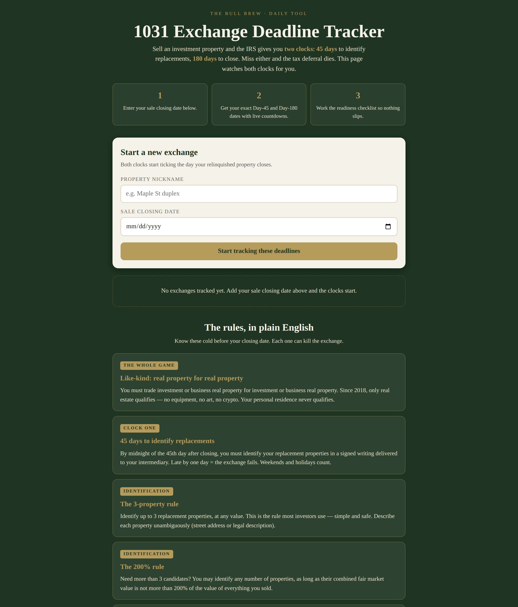

# 1031 Exchange Deadline Tracker

**Live app:** https://thebullbrew.github.io/1031-deadline-tracker/

Sell an investment property and the IRS hands you two clocks: **45 days** to identify
replacement properties, **180 days** to close. Miss either and the tax deferral dies.
This app watches both clocks for you.

## What it does

- **Two live countdowns per exchange** — enter your sale closing date and get your exact
  Day-45 identification deadline and Day-180 closing deadline as calendar dates, with
  progress bars and urgency states (on track / under 14 days / missed).
- **Multiple exchanges** — track several deals at once, each with its own clocks,
  saved in your browser via localStorage.
- **The rules, in plain English** — like-kind requirement, the three identification
  rules (3-property, 200%, 95%), the qualified-intermediary requirement, same-taxpayer
  rule, and the 180-day close (including the tax-return-due-date trap).
- **Exchange readiness checklist** — nine checks that persist per exchange, from
  "intermediary hired before closing" to "all equity reinvested."

Day 1 is the day *after* closing — verified: a 2026-01-05 closing gives
Day 45 = 2026-02-19 and Day 180 = 2026-07-04.

## Run it

No build step. Open `docs/index.html` in a browser, or visit the live link above.
It's a PWA — Add to Home Screen on iPhone for the full app feel. Works offline after
first load; your exchanges stay in the browser via localStorage.

## Deploy your own

Static files under `docs/` — publish with any static host (this repo uses GitHub Pages).

---

*Not tax advice. Always work with a qualified intermediary and your CPA or tax attorney.
Part of the daily finance & real-estate tool series. One useful tool, every day.*
